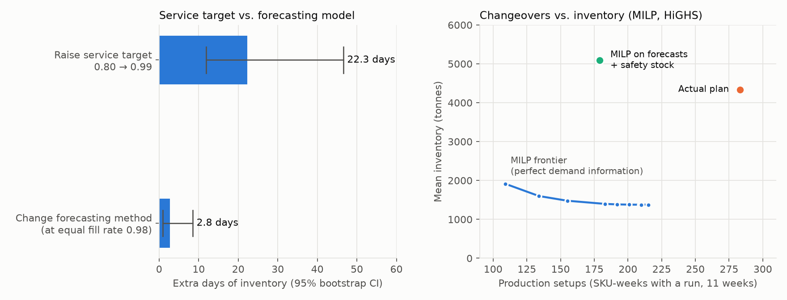

# 供應鏈計畫：先定服務水準，再談預測模型

[](https://github.com/yschang1688/supply-planning-policy/actions/workflows/tests.yml)

用一家製造商 221 天的真實日流量（訂單、生產、工廠出庫、出貨），回答計畫員每天要面對的三個問題：服務水準目標怎麼定、要放多少庫存、產能怎麼排。



> **In brief.** On 221 days of real order, production and shipment data from an FMCG manufacturer
> (SupplyGraph, 32 active SKUs), the service-level target moves inventory far more than the choice
> of forecasting model: raising the target from 0.80 to 0.99 adds 22.3 days of stock, while six
> reasonable forecasting methods differ by only 2.8 days at equal fill rate. Outside the two Eid
> holiday weeks, no method significantly beats a same-weekday average. A capacitated lot-sizing
> MILP (HiGHS) maps the changeover-versus-inventory trade-off, but run on forecasts it costs more
> than the plant's actual daily small-batch rhythm. A logistic-regression early-warning model for
> new stockouts beats the planner's age-of-oldest-order rule (PR-AUC 0.772 vs 0.601).

| 你想看 | 去這裡 |
|---|---|
| 規格：為什麼這樣做、驗收情境、KPI 定義與取捨 | [`openspec/changes/supply-planning-case/`](openspec/changes/supply-planning-case/) |
| 資料下載、sha256、品質檢核 | [`src/data.py`](src/data.py)、[`src/quality.py`](src/quality.py) |
| KPI：fill rate、FIFO 欠貨帳齡、OTIF 代理、缺貨率、庫存天數 | [`src/kpi.py`](src/kpi.py) |
| 需求預測：8 種方法、rolling-origin 回測 | [`src/forecast.py`](src/forecast.py) |
| 庫存政策模擬：(R,S)／(s,S)、三種安全庫存 | [`src/simulate.py`](src/simulate.py) |
| 產能排程 MILP：換線與庫存的取捨線 | [`src/schedule.py`](src/schedule.py) |
| 欠貨風險分類與每日警示清單 | [`src/classify.py`](src/classify.py) |

## 結論（先講重點）

| # | 發現 | 數字 |
|---|---|---|
| 1 | **服務目標對庫存的影響，遠大於換預測模型** | 目標 0.80 → 0.99 多 **22.3 天**庫存（95% 區間 11.8～46.5）；同樣 fill rate 0.98 下，6 種預測方法最多差 **2.8 天**（0.9～8.5） |
| 2 | **節日週以外，換模型的差距在雜訊內** | 排除兩個節日週後，沒有方法顯著贏過「近 4 週同星期平均」（WAPE 0.477）；最好的 LightGBM＋假期 0.433，13 週裡贏 8 週，p = 0.22 |
| 3 | **星期型態是預測的主結構** | 不分星期的 28 天平均，15 週全輸給同星期平均（WAPE 0.785 vs 0.556，p = 0.0001） |
| 4 | **常態近似的安全庫存沒有在波動 SKU 上失準**（假說不成立） | 達成率減目標：波動群 +3.0 個百分點（多保護）、穩定群 −2.5 個百分點（不足） |
| 5 | **MILP 量化了換線的代價，但用預測排程打不贏現行做法** | 完全知道需求時，開線週可從 283 降到 183；改用預測滾動排程，不帶安全庫存平均欠單 476 噸／週，帶了安全庫存總成本 62,406 仍高於現行計畫的 53,389 |
| 6 | **新發生的缺貨可以提前抓到** | 邏輯迴歸 PR-AUC **0.772**，計畫員現用的「最老未交訂單天數」規則 0.601；差距 0.17（按日 bootstrap 95% 區間 0.105～0.230） |

**給不熟供應鏈的人的三句話**

1. 要不要多放庫存，主要取決於「答應客戶多高的準時率」這個管理決定，不太取決於模型準不準。
2. 這家工廠的需求在一週裡每天差很多（週五幾乎沒有訂單），抓住這個型態就拿到大部分的準度，複雜模型只在節日週明顯有用。
3. 缺貨可以提前一週預警，但每天要發 6 個左右的警示才抓得到九成；只想發 2～3 個，就得接受漏掉一半。

## 現況 KPI（M1）

| KPI | 數值 | 定義 | 限制 |
|---|---|---|---|
| Fill rate（噸數加權） | 0.986 | 期間出貨 ÷ 期間訂單，單一 SKU 封頂 1 | 沒有逐單交期，只看量有沒有交齊 |
| 訂單交齊天數 | 中位 4 天、p90 13 天 | 先進先出，把出貨分配給每天的訂單批 | 期初欠單未知，用下限估計 |
| 7 天內交齊（OTIF 代理） | 92%（以噸計）／76%（以批計） | 7 天內交齊的訂單比例 | 準時的標準是假設，0～7 天的完整曲線在 `results/m1_kpi.json` |
| 缺貨產品日 | 23.2% | 有訂單等超過 7 天仍未交齊的產品日 | 小量 SKU 拉高了比例；A 類 8 個 SKU 有 6 個低於 2% |
| 庫存天數（下限） | 中位 4.9 天 | 重建的倉庫庫存 ÷ 近 28 天平均日需求 | 期初庫存未知，只能算下限 |

## 拿到一份倉儲資料，分析順序

1. **先弄清楚流量、單位與粒度，檢查帳平不平。** 這份資料有兩個上游錯誤：一個 SKU 的工廠出庫噸數整欄是 0，另有兩個不同產品共用同一個代碼。週五訂單也幾乎是 0（[`src/quality.py`](src/quality.py)）。
2. **重建庫存與欠單，算 KPI，說清楚哪個是下限。** 沒有期初庫存，就算「讓帳不變負的最小期初值」（[`src/kpi.py`](src/kpi.py)）。
3. **分群。** 依噸數分 ABC、依週需求波動分 XYZ，休眠 SKU 另外標（[`src/kpi.py`](src/kpi.py)）。
4. **預測，然後讓業務選服務水準。** 預測誤差是模擬的輸入，輸出是「多放幾天庫存、換到多少 fill rate」的對照表（[`src/forecast.py`](src/forecast.py)、[`src/simulate.py`](src/simulate.py)）。
5. **排產能、給警示清單，最後用一張 KPI 表交代。**（[`src/schedule.py`](src/schedule.py)、[`src/classify.py`](src/classify.py)）

## 各模組做了什麼

- **M2 需求預測**：15 個每週起點（2023-04-22～07-29），每次預測後 7 天、32 個 SKU，比較 8 種方法：季節 naive、同星期平均、28 天平均、Holt-Winters、Croston、TSB、LightGBM 全域模型（有／無公開假期）。誤差以噸數算 WAPE 與 bias，成對比較用 Wilcoxon。LightGBM 用 L1 目標，系統性低估約 7%～10%，下游的安全庫存要接住這個偏差。
- **M3 庫存政策模擬**：用實際訂單逐日重播，比較 (R,S) 與 (s,S) 兩種補貨政策、6 個服務目標、3 種安全庫存算法（常態、常態補偏差、經驗分位數）。安全庫存只用當週以前的誤差估。前置期 ±1 天的隨機延誤跑 200 次，服務目標 0.95 時 fill rate 落在 0.986～0.995。
- **M4 產能排程**：週別、有產能限制的批量問題（CLSP），含最小批量與換線成本，用 HiGHS 求解。以產品群當產線、產能取歷史週產量的 p95，這兩點都是假設。
- **M5 欠貨風險分類**：「今天已在缺貨」的 SKU，未來 7 天仍缺貨的機率是 96%，所以只預測「新發生」的缺貨。特徵都在當天算得出來，時間切分中間留 7 天空白。隨機切分會把 LightGBM 的 PR-AUC 從 0.724 拉高到 0.869，那個數字不能用。

## 限制

- 只有 221 天，看不到年度季節性。回測的 15 週裡有兩個節日週，會左右結論，所以另報排除節日週的版本。
- 沒有逐單交期、期初庫存與期初欠單：準時率是代理指標，庫存是下限。
- 模擬的服務水準算的是「當天出貨」，和工廠實際做法不同（實際上多在接單後 1～2 天出貨）。模擬的庫存天數（約 7～30 天）不能直接和現況的 4.9 天比。
- 產線與產能是假設：資料裡的廠別不是產線，一個 SKU 對到 12～24 個廠。
- SO0002L09P 有訂單但沒有任何生產紀錄，不在排程範圍內。

## 資料

SupplyGraph（Wasi, Islam & Akib, 2024, [arXiv:2401.15299](https://arxiv.org/abs/2401.15299)）：孟加拉一家 FMCG 製造商，41 SKU × 221 天（2023-01-01～2023-08-09），件數與噸數兩版。原始資料來自 [CIOL-SUST/SupplyGraph](https://github.com/CIOL-SUST/SupplyGraph)（LGPL-2.1）。本 repo 不收原檔，[`src/data.py`](src/data.py) 釘住上游 commit 與每個檔案的 sha256，執行時重抓。

## 跑起來

```bash
python -m venv .venv && .venv/bin/pip install -r requirements.txt
.venv/bin/python scripts/run_m0_m1.py      # 下載、品質報告、KPI
.venv/bin/python scripts/run_m2.py         # 預測回測（約 1 分鐘）
.venv/bin/python scripts/run_m3.py         # 庫存政策模擬＋bootstrap＋Monte Carlo（約 9 分鐘）
.venv/bin/python scripts/run_m4.py         # 產能排程 MILP（約 10 秒）
.venv/bin/python scripts/run_m5.py         # 欠貨風險分類＋警示清單（約 15 秒）
.venv/bin/python scripts/plot_summary.py   # 總覽圖
.venv/bin/python -m pytest tests/ -q
```

測試守的是邏輯，不是分數：先進先出不能寫成後進先出、預測不能偷看未來、模擬要守恆、MILP 的每條限制都要成立。每組測試都用突變探針驗過：把邏輯故意改壞，測試會紅。CI 另有一關 claim-discipline，確認本頁的數字仍與 `results/*.json` 一致。

| 結果檔 | 內容 |
|---|---|
| [`results/m0_quality.json`](results/m0_quality.json) | 品質檢核報告 |
| [`results/m1_kpi.json`](results/m1_kpi.json)、[`m1_sku_table.csv`](results/m1_sku_table.csv) | 現況 KPI、逐 SKU 表 |
| [`results/m2_forecast.json`](results/m2_forecast.json)、[`m2_backtest.csv`](results/m2_backtest.csv) | 預測回測彙總、逐日預測 |
| [`results/m3_policy.json`](results/m3_policy.json)、[`m3_grid.csv`](results/m3_grid.csv) | 政策格點、H1／H2 判定 |
| [`results/m4_schedule.json`](results/m4_schedule.json)、[`m4_frontier.csv`](results/m4_frontier.csv) | 取捨線、滾動計畫 |
| [`results/m5_classify.json`](results/m5_classify.json)、[`m5_alerts_last_day.csv`](results/m5_alerts_last_day.csv) | 分類成績、警示清單 |
